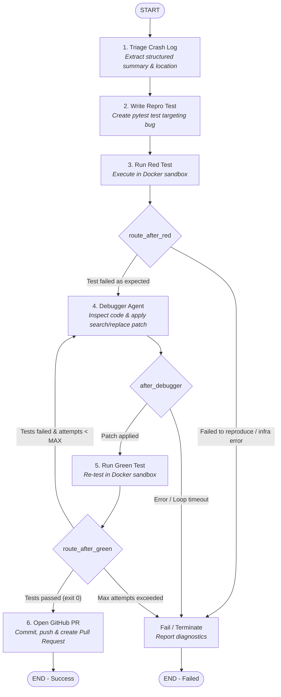

# 🩺 Self-Healing Code Agent (Autonomous SRE Auto-Fix Bot)

An autonomous Site Reliability Engineering (SRE) agent that ingests raw production crash logs, reproduces failures using automated Test-Driven Development (TDD) inside an isolated Docker sandbox, generates verified code patches, and automatically publishes a GitHub Pull Request with the resolution.

Built with **LangGraph**, **LangChain**, **Google Gemini**, and **Docker**.

---

## 🚀 Key Features

- **Automated Crash Log Triage**: Parses untrusted, noisy production logs (up to 1,000 lines) and extracts structured diagnostic metadata (`error_type`, `failing_file`, `failing_line`, `traceback`).
- **TDD Bug Reproduction (Red Phase)**: An automated QA agent generates minimal, idiomatic `pytest` unit tests and confirms they fail inside an isolated Docker sandbox.
- **Autonomous Patching (Green Phase)**: A ReAct debugging agent inspects the codebase, applies AST-validated search/replace patches, and verifies that the test suite passes.
- **Dockerized Execution Sandbox**: Untrusted code and tests run inside dynamic, ephemeral Docker containers to prevent unauthorized host access.
- **Automated GitOps & Pull Requests**: Automatically creates a dedicated fix branch (`sre-auto-fix-*`), commits changes under the bot's identity, pushes to GitHub, and opens a descriptive Pull Request with traceback and verification summaries.
- **Defense in Depth**:
  - **Repository Allowlist (`ALLOWED_REPOS`)**: Restricts the bot to authorized repositories only.
  - **Path Traversal Protection**: Rejects file operations escaping the workspace root.
  - **AST Syntax Validation**: Ensures generated patches are syntactically valid Python before writing to disk.
  - **Protected Files**: Disallows modification of existing test suites and sensitive configuration (`.env`, `.pem`, `.key`).

---

## 🏗️ Architecture & Workflow

The orchestrator operates as a compiled **LangGraph** state machine:



---

## 📋 Prerequisites

1. **Python 3.11+**
2. **Docker Desktop** (must be running for sandboxed test execution)
3. **Google Gemini API Key** (for LLM reasoning & agent planning)
4. **GitHub Personal Access Token** (with `repo` or `Contents: Read/Write` and `Pull requests: Read/Write` scopes)

---

## ⚙️ Installation & Setup

### 1. Clone the Repository
```bash
git clone https://github.com/your-username/self_healing.git
cd self_healing
```

### 2. Create and Activate Virtual Environment
```bash
# Windows
python -m venv venv
.\venv\Scripts\activate

# Linux / macOS
python3 -m venv venv
source venv/bin/activate
```

### 3. Install Dependencies
```bash
pip install -r requirements.txt
```

### 4. Configure Environment Variables
Copy `.env.example` to `.env`:
```bash
cp .env.example .env
```

Edit `.env` and provide your credentials:
```env
GOOGLE_API_KEY=your_gemini_api_key_here
GEMINI_MODEL=gemini-2.5-flash
GITHUB_TOKEN=ghp_your_github_token_here
ALLOWED_REPOS=your-github-username/your-target-repo
```

---

## 💻 Usage Example

You can trigger the self-healing pipeline by invoking `execute()` from [app/graph/graph.py](file:///c:/Users/mmish/OneDrive/Desktop/self_healing/app/graph/graph.py):

```python
from app.graph.graph import execute

# Target repository must be present in ALLOWED_REPOS in your .env
target_repo = "your-github-username/sample-calculator"

# Raw crash log from your monitoring tool / Sentry / CloudWatch
crash_log = """
Traceback (most recent call last):
  File "src/calculator.py", line 14, in divide
    return a / b
ZeroDivisionError: division by zero
"""

# Execute the self-healing loop
result = execute(path=target_repo, crash_report=crash_log)

print(f"Final Status: {result.get('status')}")
if result.get("pr_url"):
    print(f"🎉 Pull Request Created: {result.get('pr_url')}")
elif result.get("failure_reason"):
    print(f"❌ Resolution Failed: {result.get('failure_reason')}")
```

Run directly:
```bash
python -m app.graph.graph
```

---

## 🌐 FastAPI Webhook Service

You can run the self-healing agent as an HTTP Webhook service that listens for crash alerts from monitoring systems (Sentry, Datadog, Prometheus, Slack, GitHub Actions):

### 1. Start the API Server
```bash
uvicorn app.main:app --reload --port 8000
```

Interactive OpenAPI Swagger documentation will be available at:
👉 **`http://localhost:8000/docs`**

### 2. Available Endpoints

| Method | Endpoint | Description |
| :--- | :--- | :--- |
| `GET` | `/health` | Check service health and view current `ALLOWED_REPOS`. |
| `POST` | `/heal` | Receive crash report and dispatch self-healing agent in background (`202 Accepted`). |
| `POST` | `/heal?sync=true` | Synchronously run self-healing agent and return final PR URL (`200 OK`). |

### 3. Example Request (cURL)

**Asynchronous Webhook (Standard):**
```bash
curl -X POST "http://localhost:8000/heal" \
     -H "Content-Type: application/json" \
     -d '{
       "repo": "your-github-username/sample-calculator",
       "crash_report": "Traceback (most recent call last):\n  File \"src/calculator.py\", line 14, in divide\n    return a / b\nZeroDivisionError: division by zero"
     }'
```
*Response (`202 Accepted`):*
```json
{
  "status": "queued",
  "message": "Self-healing agent dispatched for your-github-username/sample-calculator. Check GitHub for PR."
}
```

**Synchronous Mode (Wait for PR):**
```bash
curl -X POST "http://localhost:8000/heal?sync=true" \
     -H "Content-Type: application/json" \
     -d '{
       "repo": "your-github-username/sample-calculator",
       "crash_report": "ZeroDivisionError in calculator.py:14"
     }'
```

---

## 🔒 Security & Sandboxing Design

| Layer | Defense Mechanism |
| :--- | :--- |
| **Workspace Isolation** | Each run clones the target repository into an isolated, ephemeral directory (`tempfile.mkdtemp`) that is automatically purged on exit. |
| **Path Sandboxing** | `Workspace.safe_path()` checks `Path.is_relative_to()` to prevent directory traversal attacks (e.g., `../../etc/passwd`). |
| **Docker Sandboxing** | Pytest execution is confined inside Docker containers mounting the repo with strict timeout caps (120s). |
| **Safe Patching** | Search/replace patches require exact unique block matching and are pre-validated via Python's `ast.parse` before writing. |
| **Protected Files** | Test harness integrity is maintained by blocking the agent from modifying existing test suites or secret files (`.env`, `.pem`, `.key`). |

---

## 📁 Project Structure

```text
self_healing/
├── app/
│   ├── main.py               # FastAPI webhook server & background task dispatcher
│   ├── config.py             # Settings & environment variable validation
│   ├── gitops/
│   │   ├── client.py         # GitHub REST API client & repo allowlist enforcement
│   │   └── pull_request.py   # Automated git commit, branch push & PR generation
│   ├── graph/
│   │   └── graph.py          # Core LangGraph state machine & node logic
│   ├── sandbox/
│   │   └── docker_tool.py    # Docker container builder & pytest runner
│   ├── tools/
│   │   ├── ast_validator.py  # Python AST syntax verification
│   │   └── file_tools.py     # Safe file inspection & search/replace patching
│   └── workspace/
│       └── manager.py        # Ephemeral git workspace manager
├── .env.example              # Environment variables template
├── .gitignore                # Comprehensive Git ignore rules
├── requirements.txt          # Python dependencies
└── README.md                 # Project documentation
```
